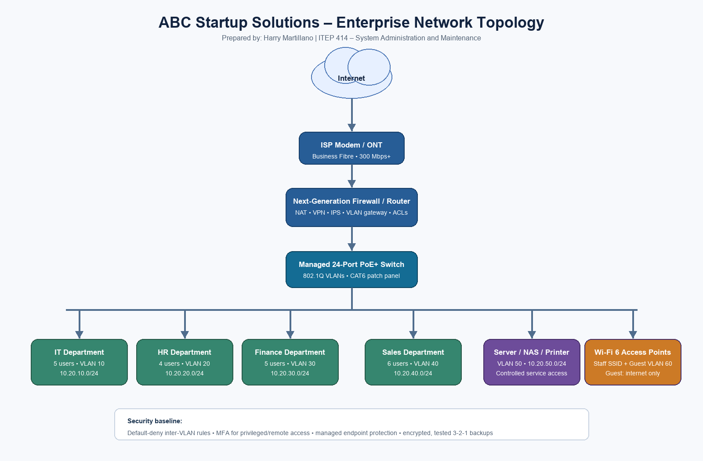

# Week 2 – Enterprise Infrastructure Planning for a Startup Company

## Project Overview

This project is an initial infrastructure plan for **ABC Startup Solutions**, a 20-person software development company starting with no existing IT equipment or network. The plan translates business needs into a practical, secure, and scalable office design before equipment is purchased or deployed.

**Prepared by:** Harry Anthony A. Martillano  
**Course:** ITEP 414 – System Administration and Maintenance

## Learning Objectives

- Analyze the technical requirements of a small organization.
- Produce concise hardware, software, and network inventories.
- Design a logical network topology with department separation.
- Explain how IT support, network, Linux, and cloud roles collaborate.
- Make evidence-based recommendations for security, backup, and growth.

## Company Scenario

| Item | Plan |
| --- | --- |
| Company | ABC Startup Solutions |
| Nature of business | Custom web and mobile software development services |
| Fictional location | 2nd Floor, Laguna Tech Hub, Santa Cruz, Laguna, Philippines |
| Vision | To be a trusted Philippine software partner that delivers useful, secure digital products. |
| Mission | To build reliable client solutions through collaborative teams, secure engineering practices, and responsive support. |
| Organization | Managing Director → IT, Human Resources, Finance, and Sales department leads → staff |
| Employee distribution | IT: 5; HR: 4; Finance: 5; Sales: 6; **Total: 20** |

## Hardware Inventory Summary

| Asset ID | Hardware | Qty. | Department | Purpose / justification |
| --- | --- | ---: | --- | --- |
| HW-001 | Business desktop, Core i5/Ryzen 5, 16 GB RAM, 512 GB SSD | 18 | HR, Finance, Sales | Fixed workstations for routine office productivity and line-of-business work. |
| HW-002 | Business laptop, Core i7/Ryzen 7, 16 GB RAM, 1 TB SSD | 5 | IT | Supports development, administration, mobility, and local virtualization. |
| HW-003 | Rack/tower server, Xeon/EPYC, 64 GB ECC RAM, RAID-1 SSD + RAID-5 HDD | 1 | IT | Hosts identity, file/print, monitoring, and internal test workloads. |
| HW-004 | 24-inch IPS monitor | 23 | All departments | One display for each endpoint; improves productivity and ergonomic use. |
| HW-005 | Multifunction laser printer | 2 | Shared | One near Finance/HR and one near Sales; reduces queueing and supports secure print release. |
| HW-006 | 1500 VA UPS | 2 | Server/network | Protects the server, NAS, firewall, switch, and modem during short outages. |
| HW-007 | 4-bay NAS, 16 TB usable RAID-5/6 | 1 | IT | Local backup target with snapshots and role-based folders. |
| HW-008 | Encrypted external backup drive, 8 TB | 2 | IT | Rotated offline/off-site copies for recovery from ransomware or NAS failure. |

## Software Inventory Summary

| Software | Version / edition | License | Purpose |
| --- | --- | --- |
| Windows 11 Pro | Current supported release | Commercial, 23 devices | Business desktop OS with domain/Entra join and BitLocker support. |
| Ubuntu Server | 24.04 LTS | Open source | Stable Linux services, monitoring, and internal tooling. |
| Microsoft 365 Business Standard | Current | Subscription, 20 users | Email, collaboration, Office apps, and cloud file sharing. |
| Visual Studio Code | Current stable | Free | Source, script, and configuration editing. |
| Git | Current stable | GPLv2 | Version control for IT scripts and documentation. |
| GitHub Desktop | Current stable | Free | Accessible Git workflow for project repositories. |
| VirtualBox | Current stable | GPLv3 | Safe local test VMs for IT staff. |
| Google Chrome | Current stable | Freeware | Managed browser for cloud services and documentation. |
| Microsoft Defender for Business | Current | Included with selected Microsoft 365 plan | Endpoint protection, alerting, and device security. |
| AnyDesk | Current stable | Commercial/business | Audited remote support when user consent and MFA are enabled. |
| 7-Zip | Current stable | LGPL | Archive handling and encrypted file packaging. |

Windows 11 Pro is selected because its edition supports domain/Entra joining and BitLocker. Ubuntu 24.04 LTS is appropriate for server work because Canonical provides long-term maintenance. See the [Microsoft licensing comparison](https://learn.microsoft.com/en-us/windows/security/licensing-and-edition-requirements) and [Ubuntu Server documentation](https://ubuntu.com/server/docs/).

## Enterprise Network Inventory

| Asset ID | Equipment | Qty. | Specification / role |
| --- | --- | ---: | --- |
| NET-001 | Business fibre ISP modem/ONT | 1 | Terminates a minimum 300 Mbps symmetrical business connection. |
| NET-002 | Next-generation firewall/router | 1 | NAT, VPN, VLAN routing, IPS, web filtering, and policy enforcement. |
| NET-003 | Managed 24-port Gigabit PoE+ switch | 1 | VLAN-capable core/access switch; PoE powers access points. |
| NET-004 | Wi-Fi 6 access point | 2 | Provides staff and isolated guest wireless coverage across the floor. |
| NET-005 | 24-port CAT6 patch panel | 1 | Cleanly terminates structured cabling in the rack. |
| NET-006 | CAT6 horizontal/patch cable runs | 30 | Connects desks, printers, APs, and rack equipment with spare capacity. |
| NET-007 | RJ45 connectors/keystones | 40 | Terminations and contingency spares. |

### Network Segmentation Plan

| VLAN | Network | Users / devices | Access rule |
| --- | --- | --- | --- |
| 10 | 10.20.10.0/24 | IT and administration | May administer infrastructure through named accounts. |
| 20 | 10.20.20.0/24 | HR | May access HR services and approved internet resources. |
| 30 | 10.20.30.0/24 | Finance | May access finance services; restricted from other user VLANs. |
| 40 | 10.20.40.0/24 | Sales | May access sales services and approved internet resources. |
| 50 | 10.20.50.0/24 | Server/NAS/printers | Accessible only through explicit firewall rules. |
| 60 | 10.20.60.0/24 | Guest Wi-Fi | Internet only; no access to internal subnets. |

Using a firewall with VLAN-aware switching keeps departments logically separated while allowing only the services they need. This follows the principle that internal servers should sit in protected internal zones and that VLANs maintain Layer-2 separation ([Cisco guidance](https://www.cisco.com/site/us/en/learn/topics/small-business/how-to-setup-a-firewall.html)).

## Enterprise Network Diagram

- [Open PNG diagram](diagrams/ABC-Startup-Solutions-Network-Topology.png)
- [Open PDF diagram](diagrams/ABC-Startup-Solutions-Network-Topology.pdf)
- [Open editable Draw.io diagram](diagrams/ABC-Startup-Solutions-Network-Topology.drawio)
- [Open editable SVG source](diagrams/ABC-Startup-Solutions-Network-Topology.svg)

## System Administration Roles

### Helpdesk Technician

Helpdesk technicians receive, classify, and resolve user incidents such as login, software, device, printing, and connectivity problems. They document tickets, prepare devices, manage routine account tasks, and escalate issues with useful diagnostic details. Key skills include customer communication, Windows troubleshooting, endpoint basics, ticket management, and documentation. Typical tools are a service desk, remote-support software, Microsoft 365 admin tools, and endpoint-management consoles. Appropriate certifications include CompTIA A+ and ITIL Foundation.

### Network Administrator

A network administrator designs, configures, monitors, and troubleshoots LAN, Wi-Fi, VPN, routing, switching, and firewall policies. The role needs TCP/IP, DNS, DHCP, VLAN, wireless, security, and change-management skills. Common tools include firewall/switch dashboards, Wireshark, monitoring systems, and configuration backups. Useful certifications include CompTIA Network+, Cisco CCNA, and vendor firewall credentials.

### Linux System Administrator

A Linux system administrator installs, hardens, patches, automates, monitors, and recovers Linux services. They manage users and permissions, storage, systemd services, SSH, logs, backups, and scripting. Common tools include Bash, SSH, Ansible, Git, journalctl, and monitoring software. Relevant certifications include Linux+, LPIC-1, Red Hat Certified System Administrator, and Linux Foundation Certified System Administrator.

### Cloud Administrator

A cloud administrator manages cloud identities, subscriptions/accounts, virtual resources, networking, storage, security controls, costs, backups, and availability. The role needs IAM, virtual networking, automation, monitoring, governance, and incident-response skills. Common tools include Microsoft Azure, AWS, CloudShell/CLI, Terraform, and cloud monitoring dashboards. Suitable certifications include AWS Certified Cloud Practitioner or SysOps Administrator – Associate, Microsoft Azure Administrator Associate, and Google Associate Cloud Engineer.

Together, these professionals form a support chain. The helpdesk identifies and resolves user-facing issues first and captures accurate tickets. The network administrator maintains secure, available connectivity; the Linux administrator keeps internal services healthy; and the cloud administrator operates the organization’s SaaS and cloud resources. They share documentation, alerts, change records, and escalation paths so an issue can be resolved at the right technical level without losing context.

## Infrastructure Recommendations

1. **Internet:** procure a business fibre plan of at least 300 Mbps symmetrical with a static IP, documented SLA, and an LTE/5G backup link for essential continuity. Software development, cloud collaboration, and video calls all benefit from reliable upstream bandwidth.
2. **Server:** deploy a server with ECC memory, redundant storage, a 3-year support warranty, TPM, and remote management. Run critical services as separate, backed-up virtual machines rather than placing all roles on one unmanaged OS installation.
3. **Backups:** use a 3-2-1 approach: production data, NAS snapshots, and encrypted external drives rotated off-site; add immutable cloud backup for Microsoft 365. Test restores quarterly and record the recovery results.
4. **Security:** place the firewall between the ISP and every internal VLAN; deny inter-VLAN traffic by default, allow only required services, maintain firmware/patching, centralize logs, and remove local administrator rights from daily accounts. Require phishing-resistant MFA wherever possible, especially for privileged and remote access, as recommended by [CISA](https://www.cisa.gov/audiences/small-and-medium-businesses/secure-your-business/require-multifactor-authentication).
5. **Endpoint protection:** use centrally managed Microsoft Defender for Business, enable disk encryption, and investigate high-severity alerts through a documented incident process.
6. **Password policy:** use unique long passphrases, a password manager, MFA, breached-password blocklists, and rate limiting; reset passwords on compromise rather than on an arbitrary schedule. This aligns with [NIST SP 800-63B](https://pages.nist.gov/800-63-4/sp800-63b.html).
7. **Expansion:** reserve address space and rack/switch capacity for at least 10–15 additional employees. A second 24-port PoE switch and additional access point can be added without redesigning the VLAN scheme.

## Technologies Used

Markdown, Git/GitHub, SVG network diagram, Google Chrome PDF export, Microsoft 365, Windows 11 Pro, Ubuntu Server, VLANs, CAT6 Ethernet, Wi-Fi 6, NAS storage, and firewall policy controls.

## Project Files

- [Network-topology preview](images/network-topology-preview.png)
- [Source register](references/sources.md)

## Challenges Encountered

- Turning a business scenario into quantities required balancing the immediate 20-person need with spare capacity for growth.
- The network diagram needed to remain readable while showing both the physical traffic path and departmental segmentation.
- Selecting security controls required avoiding a single control: backups, MFA, endpoint protection, VLANs, and least privilege work together.

## Reflection

This activity showed me that infrastructure planning is a business task as well as a technical one. Before this project, it was easy to think of a network as simply an internet line, a router, and computers. The scenario made me consider the people who use the systems, the data they handle, the consequences of downtime, and the documentation that lets another technician understand the environment.

The most challenging task was deciding how to separate the departments without making the design unnecessarily complex. Finance and HR handle more sensitive information, while Sales needs reliable access to customer-facing tools. Creating VLANs and firewall rules gave each group a logical boundary while allowing the server, printer, and internet services that they genuinely need. It also showed me why security should be planned before devices are connected.

Planning before deployment reduces costly changes later. It identifies quantities, compatibility, IP addressing, cabling, backup locations, account controls, and recovery requirements while they are still easier to change on paper. The inventory tables and diagram also provide a baseline for purchasing, implementation, troubleshooting, and future audits.

This project helps prepare me for system administration because it practices a repeatable way of thinking: understand the organization, document assumptions, select appropriate technology, protect critical services, and leave clear records. I learned that a good administrator must be able to explain technical decisions in a way that management and other IT staff can use. I will apply this planning mindset to future server, network, cloud, and security activities.

I also learned that an infrastructure plan is a living document. Once equipment is purchased, the inventory should be updated with real asset tags, serial numbers, warranty dates, assigned users, and configuration backups. When the company grows or changes its services, the network diagram and access rules should be reviewed instead of relying on memory. Maintaining those records will make troubleshooting faster and will make handovers between IT staff safer. This project therefore strengthened both my technical planning skills and my responsibility to maintain accurate documentation throughout the lifecycle of a system.

## References

1. [Microsoft Learn – Windows security features and edition requirements](https://learn.microsoft.com/en-us/windows/security/licensing-and-edition-requirements)
2. [Ubuntu Server documentation](https://ubuntu.com/server/docs/)
3. [Cisco – Firewall guidance for small businesses](https://www.cisco.com/site/us/en/learn/topics/small-business/how-to-setup-a-firewall.html)
4. [CISA – Require multifactor authentication](https://www.cisa.gov/audiences/small-and-medium-businesses/secure-your-business/require-multifactor-authentication)
5. [NIST SP 800-63B – Authentication and lifecycle management](https://pages.nist.gov/800-63-4/sp800-63b.html)
6. [AWS Certified Cloud Practitioner](https://aws.amazon.com/certification/certified-cloud-practitioner/)

---

The complete eight-part report is available as [EnterpriseInfrastructurePlan.pdf](EnterpriseInfrastructurePlan.pdf).
